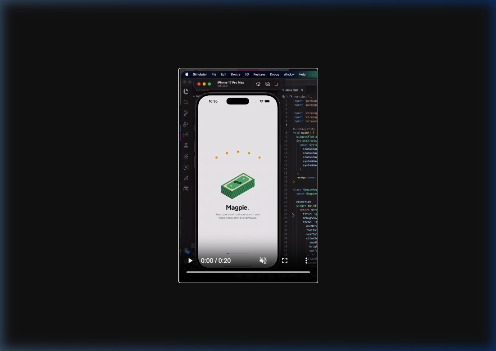
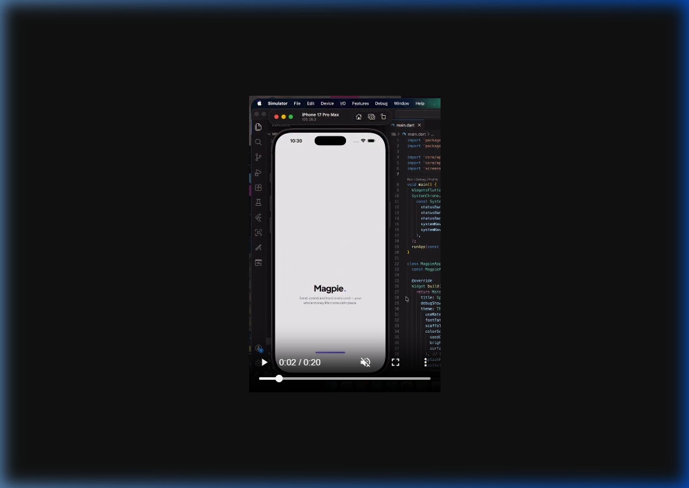
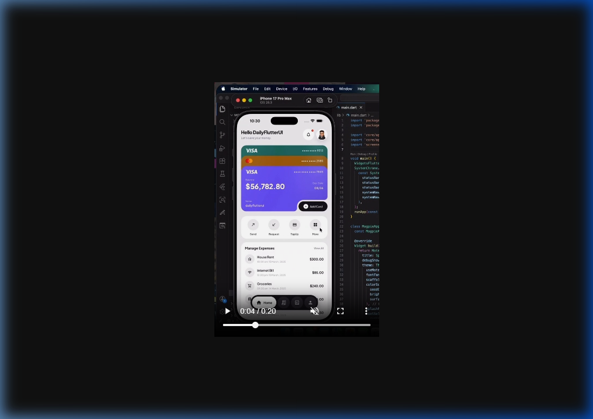
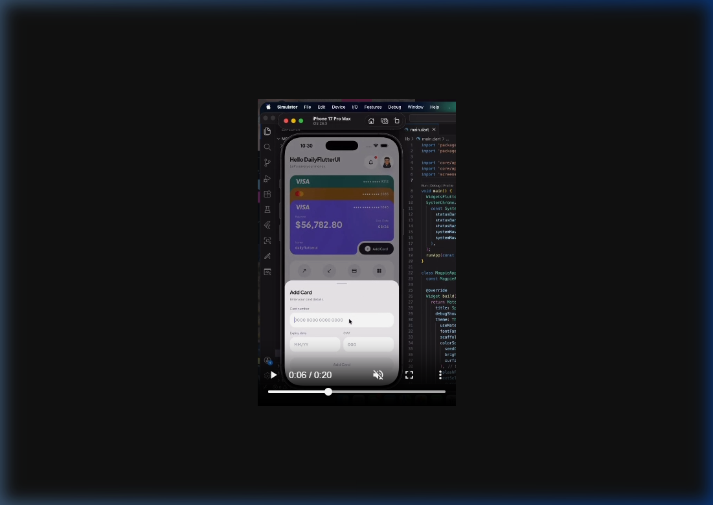
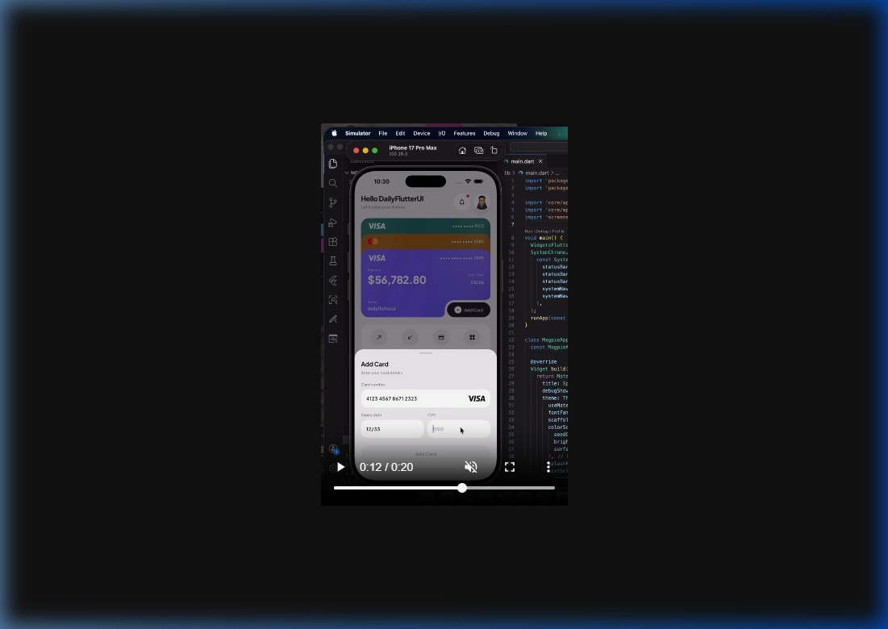
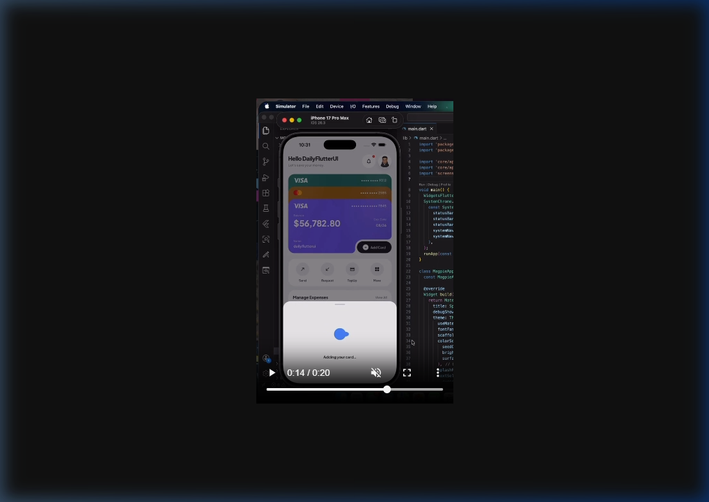

# Magpie — Credit Card Manager (Flutter Recreation)

**Proposal & Roadmap**

> Reference: `D:\python\Design Ideas\credit card manager.mp4` (20 s, iOS Simulator, iPhone 17 Pro Max, built by *DailyFlutterUI* in Flutter).
> Goal: recreate the same UI, animations and flow at the same level of polish, in `d:\python\Flutter\my_app`.

---

## 1. What the app is

**Magpie** is a light-themed, minimal fintech app: *"Send, spend and track every card — your whole money life in one calm place."*
The video shows 3 screens and 1 key flow:

| # | Time | Screen | Reference |
|---|------|--------|-----------|
| 1 | 0:00–0:01 | **Splash (illustration)**: isometric green cash stack, 5 orange coins in an arc above it, `Magpie.` wordmark + tagline |  |
| 2 | 0:01–0:03 | **Splash (brand)**: illustration fades out, wordmark stays, purple progress bar fills at the bottom |  |
| 3 | 0:03–0:05 | **Home dashboard**: stacked cards, quick actions, expense list, floating dark nav bar |  |
| 4 | 0:05–0:12 | **Add Card bottom sheet**: live card-number formatting, Visa detection, expiry + CVV |   |
| 5 | 0:13–0:20 | **Adding your card…**: sheet shrinks, blue "gooey" morphing-dot loader |  |

---

## 2. UI breakdown (what we must match)

### Design tokens (estimated from the video)
| Token | Value |
|---|---|
| Background | `#ECEBEF` (soft cool grey) |
| Surface (sheets, tiles) | `#F5F5F7` / `#FFFFFF` |
| Text primary / secondary | `#151515` / `#8A8A8E` |
| Brand accent (dot in `Magpie.`, progress bar) | `#5B3FD6` purple |
| Card 1 (back) | Deep teal `#2F6B5E` |
| Card 2 (middle) | Mustard/amber `#B7832F` (Mastercard) |
| Card 3 (front) | Violet `#6A4FE6` → `#5A3FD8` |
| Dark pill (Add Card btn, nav bar) | `#1C1C1E` |
| Loader | Blue `#3D7BF0` |
| Font | Geometric sans: **Plus Jakarta Sans** (or Manrope) via `google_fonts` |
| Radii | Cards 20, tiles/sections 18, inputs 14, pills 999 |

### Home screen, top to bottom
1. **Header**: `Hello DailyFlutterUI` (bold, ~20) + `Let's save your money.` (muted, ~12). Right side: bell in a white circle with a red badge, plus a round avatar.
2. **Card stack**: 3 cards overlapped vertically. Only the header strip (network logo + `•••• •••• 9312`) of the back cards shows. The front card shows:
   - `VISA` + `•••• •••• •••• 7845`
   - `Balance` / **`$56,782.80`** (large, bold) · `Exp. Date` / `08/26` (right)
   - `Name` / `dailyflutterui`
   - **Inverted-corner notch** in the bottom-right holding a dark `⊕ Add Card` pill. This is the main detail; it needs a `CustomClipper`.
3. **Quick actions** (white rounded panel): `Send ↗`, `Request ↙`, `TopUp ▭`, `More ⊞`. Each is a circular grey icon with a label.
4. **Manage Expenses** (white rounded panel, `View All` on the right): rows with icon circle, title, timestamp, amount.
   - House Rent: `10:00 am 15 March, 2025`, `$300.00`
   - Internet Bill: `$85.00`
   - Groceries: `$240.00`
   - more rows (scrollable)
5. **Floating bottom nav**: dark rounded pill floating above the content. The active tab expands into a lighter pill with icon + `Home` label. The other three are icon-only (Cards, Stats, Profile).

### Add Card sheet
- Grabber, `Add Card` title, `Enter your card details.`
- `Card number` field, hint `0000 0000 0000 0000`. Groups digits in 4s as you type. A **VISA logo animates in** once the BIN is detected.
- `Expiry date` (`MM/YY`, auto-slash) and `CVV` (`000`) side by side.
- Full-width `Add Card` button, disabled (faded) until the form is valid.
- The barrier dims the home screen.

### Adding state
- The sheet **animates its height down** to a compact panel.
- Loader: 2–3 blue blobs that merge and split (a metaball / "gooey" effect), with `Adding your card...` below.
- Next step (implied): the sheet closes and **the new card slides into the stack**.

---

## 3. Animations (where the effort goes)

| Animation | Implementation |
|---|---|
| Splash coins dropping into cash stack, then illustration fade/scale out | `AnimationController` + staggered `Interval`s (or a **Rive/Lottie** file) |
| Splash bottom progress bar filling | `TweenAnimationBuilder` on width |
| Splash → Home | `PageRouteBuilder` fade + slight slide |
| Home content entrance (cards drop in, sections stagger) | `flutter_animate` stagger |
| Card stack tap → bring card to front / expand stack | `AnimatedPositioned` + `AnimatedScale`, spring curve |
| Add Card sheet slide-up | `showModalBottomSheet` with custom `AnimationController` (easeOutCubic ~350 ms) |
| VISA / Mastercard logo appearing | `AnimatedSwitcher` (fade + scale) |
| Sheet height shrink to loader | `AnimatedSize` |
| Gooey blob loader | `CustomPainter` + blur/threshold `ColorFilter` (metaball) |
| Nav bar active pill | `AnimatedContainer` width + `AnimatedSwitcher` label |
| Balance counter | `TweenAnimationBuilder<double>` count-up |

---

## 4. Tech stack

| Concern | Choice |
|---|---|
| Framework | Flutter 3.x (stable), Material 3, `useMaterial3: true` |
| State | **Riverpod** (`flutter_riverpod`), simple and testable |
| Fonts | `google_fonts` (Plus Jakarta Sans) |
| Animations | built-in + `flutter_animate` |
| Icons | `lucide_icons` / `iconsax` (matches the thin outline style) |
| Illustrations | SVG via `flutter_svg` (cash stack, coins, card logos) |
| Local persistence | `hive` / `shared_preferences` (saved cards, mock data) |
| Card input | custom `TextInputFormatter`s + Luhn check + BIN detection |
| System UI | `SystemChrome` transparent status bar, dark icons (also visible in the reference `main.dart`) |

**No backend is required** to match the video. All data is mock/local. A real payments backend (Stripe, etc.) is out of scope; see Phase 6.

---

## 5. Project structure

```
lib/
├─ main.dart                  # MagpieApp, theme, SystemChrome
├─ core/
│  ├─ theme/                  # colors.dart, typography.dart, app_theme.dart
│  ├─ utils/                  # card_formatters.dart, luhn.dart, card_brand.dart
│  └─ widgets/                # pill_button.dart, section_card.dart, gooey_loader.dart
├─ data/
│  ├─ models/                 # credit_card.dart, expense.dart
│  └─ repositories/           # card_repository.dart (mock + Hive)
├─ features/
│  ├─ splash/                 # splash_screen.dart, cash_stack_animation.dart
│  ├─ home/                   # home_screen.dart, card_stack.dart, notched_card_clipper.dart,
│  │                          # quick_actions.dart, expense_list.dart
│  ├─ add_card/               # add_card_sheet.dart, adding_state.dart
│  └─ shell/                  # floating_nav_bar.dart, app_shell.dart (IndexedStack)
assets/
├─ svg/                       # cash_stack.svg, coin.svg, visa.svg, mastercard.svg
└─ images/                    # avatar.png
```

---

## 6. Roadmap

| Phase | Deliverable | Est. |
|---|---|---|
| **0. Setup** | Packages, folders, theme tokens, fonts, SystemChrome, assets | 0.5 day |
| **1. Static Home UI** | Header, card stack with notched clipper, quick actions, expense list, floating nav. Pixel-match against `03_home.png` | 1.5 days |
| **2. Add Card sheet** | Sheet UI, formatters (4-4-4-4, MM/YY), Luhn validation, brand detection + animated logo, button enabled state | 1 day |
| **3. Adding flow** | Sheet height morph, gooey loader, new card inserted into the stack with animation, state via Riverpod | 1 day |
| **4. Splash** | Cash-stack + coin-drop animation, fade to brand, progress bar, transition to Home | 1 day |
| **5. Polish** | Entrance staggers, card tap-to-front, nav pill animation, balance count-up, haptics, side-by-side comparison with the video | 1 day |
| **6. Beyond the video (optional)** | Cards / Stats (charts via `fl_chart`) / Profile tabs, Send/Request/TopUp screens, freeze card, persistence, dark mode | later |

**Total to match the video: about 6–7 working days.**

---

## 7. Requirements

- **Tools:** Flutter SDK (installed), an Android emulator or iOS simulator, VS Code / Android Studio.
- **Assets:** isometric cash stack + coin SVGs (we generate or source them), Visa/Mastercard logos, an avatar image.
- **Reference:** the frames in `docs/reference/` for pixel comparison at every phase.

## 8. Definition of done

- [ ] Splash → Home → Add Card → Adding → card appears, matching the video's flow and timing
- [ ] Side-by-side screenshots match colors, spacing, radii and typography
- [ ] All animations run at 60 fps on a mid-range device
- [ ] Card form rejects invalid numbers and detects Visa/Mastercard
- [ ] Clean feature-first structure, no hardcoded magic values outside the theme
