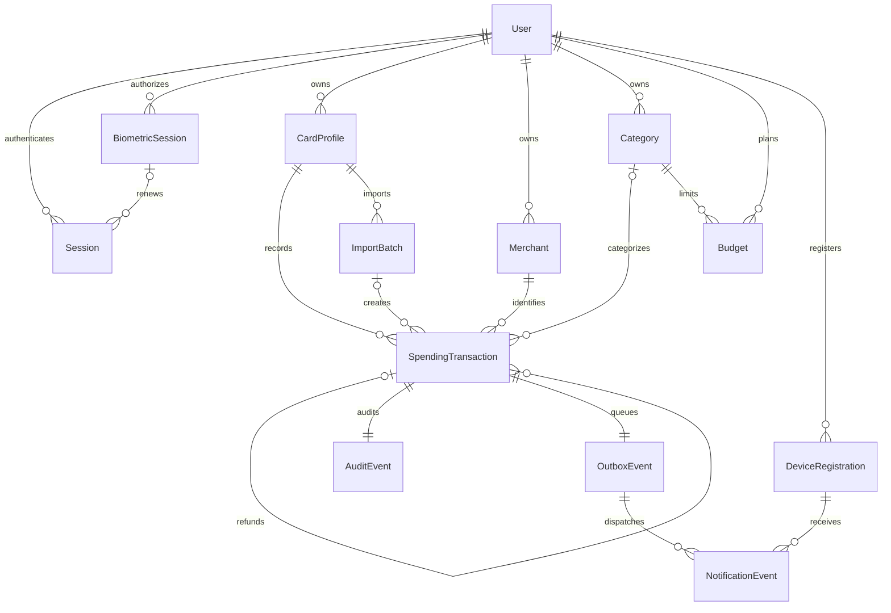

# SpendTrail design and acceptance contract

Updated 8 November 2026. This document closes the initial design backlog and
distinguishes delivered foundations from planned features. SQL migrations and
the backend API models are the executable schema and validation contract.

## Reusable screens and demo assumptions

| Existing screen | SpendTrail use and remaining integration |
| --- | --- |
| Splash, sign-in, registration | Delivered account entry, appearance and biometric session handling. |
| Home and wallet/card stack | Reused visual shell. Account purchases and card profiles use PostgreSQL; displayed demo balances/card stack remain local examples. Account Home replaces Send/Request/TopUp shortcuts with the purchase/refund route. |
| Account card profiles | Delivered owned fictional metadata, create/edit/archive. Archival preserves history. |
| Account purchases and details | Delivered manual/CSV/simulated records, categories, search, filters, pagination and refunds. No transaction deletion or financial-field editing. |
| Local Expenses | Legacy review mode; unrestricted local edits/deletes must not be copied into account transactions. |
| Statistics | Signed-in sessions use server monthly reports, per-card/category totals and budget editing/progress. Legacy demo mode keeps its local statistics. |
| Profile | Reused appearance/security controls. Local profile preferences do not change account identity. |
| Demo action screens | Retained for explicit legacy demo mode. Account sessions use server simulations instead. |

No screen infers a bank balance, payment success, bank connection or notification
delivery from adding a card. Full card numbers, CVVs and banking credentials are
outside the account data model.

## Relationships

DeviceRegistration and NotificationEvent are planned. Budgets are implemented. The existing
transaction outbox stores committed creation events; dispatch is pending.

## Data dictionary

| Record | Fields and rules |
| --- | --- |
| User | UUID id, case-insensitive unique email, name, Argon2 password hash, created timestamp. |
| Session | Hashed bearer credential, user, expiry, optional owned biometric credential. Access is revocable and lasts at most 12 hours. |
| BiometricSession | UUID id, user, hashed credential, absolute expiry up to 30 days, revoked flag; device secret stays in biometric-bound storage. |
| CardProfile | UUID id, owner, label, network, last4, expiry month/year, archived flag, created timestamp. Unique owner/network/last4, including archived cards. |
| Merchant | UUID id, owner, bounded name; unique owner/name. |
| Category | UUID id, owner, bounded name; case-insensitive unique name per owner. Starter categories are owned separately by each account. |
| SpendingTransaction | UUID id, owner, card, merchant, positive NUMERIC(14,2) amount, timestamp, source, reference, kind, status, channel, current/original category, optional import batch and original purchase. Composite references enforce ownership. Unique card/source/reference. Creation fields are immutable; current category is editable. PKR is implicit in storage and explicit in API output. |
| ImportBatch | UUID id, owner/card, bounded filename, file hash, preview token, bounded JSON row outcomes, status, counts, exact total, timestamps. No raw CSV retention. |
| AuditEvent / OutboxEvent | One row each per transaction, keyed by transaction UUID, with creation timestamp. Inserted atomically by a database trigger. Restricting runtime-role audit privileges remains pending. |
| Budget | UUID id, owner, owned category, first day of reporting month, positive exact PKR limit, updated timestamp; unique owner/category/month. |
| DeviceRegistration (planned) | UUID id, owner, platform, device token, enabled flag, timestamps. Reassign/remove tokens when the signed-in account changes. |
| NotificationEvent (planned) | Stable event id, committed transaction, device, attempt count, next attempt, accepted/failed state and bounded last error. Provider acceptance and observed receipt are distinct evidence. |

## Transaction semantics

- Sources: `manual`, `csv`, `simulation`. Channels: `online`, `pos`.
- Types: `purchase`, `refund`. States: `approved`, `declined`.
- Manual and CSV records are approved purchases. Simulated purchases explicitly
  choose approved/declined; simulated refunds are approved only.
- Amounts are positive exact PKR values. Signed spending is approved purchase
  amount minus approved refund amount; a decline contributes zero. The
  `transaction_spending` SQL view supplies `spending_amount` for future reports.
- Refunds reference an owned approved purchase on the same card and merchant,
  inherit its channel/category at recording, and cannot precede it. Multiple
  partial refunds are allowed, with total approved refunds at most the purchase
  amount. Refunds of refunds and declined purchases are rejected. Archived cards
  accept refunds and matching retries; they reject new purchases.
- Creation values cannot be edited. Current category may change independently,
  including for archived history. Each transaction's current category governs
  its category grouping; a later recategorization does not silently change other
  records. Original creation category remains available for idempotency.
- No account transaction delete endpoint. Corrections use linked refunds and a
  new purchase. Audit privilege restrictions are a separate pending task.
- Card locking serializes API creation/retry/import/refund paths. A database
  trigger also locks the original purchase and checks the refund ceiling for
  direct SQL inserts. Failed writes roll back the transaction/audit/outbox set.
- Reusing a reference with the same complete creation body returns the existing
  transaction; changing its original values returns 409. Sources have separate
  reference namespaces. A retry never recategorizes an existing record.

## API and CSV contracts

See [the complete API contract](../backend/README.md) and
[the CSV contract](CSV_IMPORT.md) for fields, limits and responses. Protected
routes enforce bearer authentication and ownership. Unrecognized request fields
are rejected. Missing/foreign records return 404, validation errors 422,
conflicting references or excessive refunds 409. Creation returns 201, matching
replay 200. Date filters are inclusive start/exclusive end, before pagination.

## Reporting time and fixed acceptance examples

Server monthly reports/budgets use **Asia/Karachi** calendar months:
November 2026 starts `2026-11-01T00:00:00+05:00` and ends immediately before
`2026-12-01T00:00:00+05:00`. History's user-selected date range continues to use
the device's local calendar. Refunds affect spending in their own occurrence
month, so a later month may have negative net spending.

| Example in one account/category/card | November contribution |
| --- | ---: |
| Approved purchase 5 November | 1,250.05 |
| Approved purchase 30 November at 23:59:59 PKT | 300.00 |
| Declined purchase 10 November | 0.00 (recorded amount 900.00) |
| Approved partial refund 6 November | -250.05 |
| Approved purchase 1 December at 00:00 PKT | 0.00 (December amount 50.00) |
| **November net spending** | **1,300.00** |

With a PKR 1,500.00 category budget, expected November remaining is PKR 200.00
and progress is 86.67% rounded for display. These values are verified through
the report/budget API in `backend/tests/test_budgets.py`; the signed-spending
fixture also remains in `backend/tests/test_simulation.py`.

Budgets cover all cards, do not roll over and are advisory rather than blocking
purchases. Set, edit or remove a limit independently for each month. Negative
spending after refunds can leave more than the original limit remaining.
Displayed progress bars clamp to 0–100%; the accompanying percentage and amounts
remain signed and show over-budget or negative-net cases explicitly.

## Remaining acceptance conditions

| Feature | Acceptance condition |
| --- | --- |
| Accounts/cards | Fresh-client sign-in restores owned cards; another account gets no access. Delivered evidence in milestone 01. |
| Manual/history/categories | Save/retry, search and combined filters yield owned records with exact amounts; recategorization preserves creation replay. Delivered evidence in milestones 02/03. |
| Biometric login | Android opt-in, restart/lock, expiry and revocation work without saving passwords. Delivered evidence in milestone 04. |
| CSV | Preview without insert; invalid row blocks all; confirmation/reupload cannot duplicate transactions/events. Delivered evidence in milestone 05. |
| Simulation/refunds | Decline has zero spending, linked partial refunds count once and concurrent requests cannot over-refund. Evidence in milestone 06. |
| Reports/budgets | Per-card and combined November totals match the table; unique monthly budgets, remaining/progress and negative-month cases are verified. Delivered evidence in milestone 07. |
| Notifications | Permission denial leaves save usable; committed events retry with a bound; tap opens the authorized transaction; event IDs suppress client repeats. Pending, including real-device receipt. |
| Evaluation | Repeatable 10k/100k workloads preserve raw plans/timings/buffers/index sizes and report cases without improvement. Pending. |
| Delivery | Fresh setup, end-to-end journey, device/accessibility checks, backup restoration totals and review build pass. Pending. |
